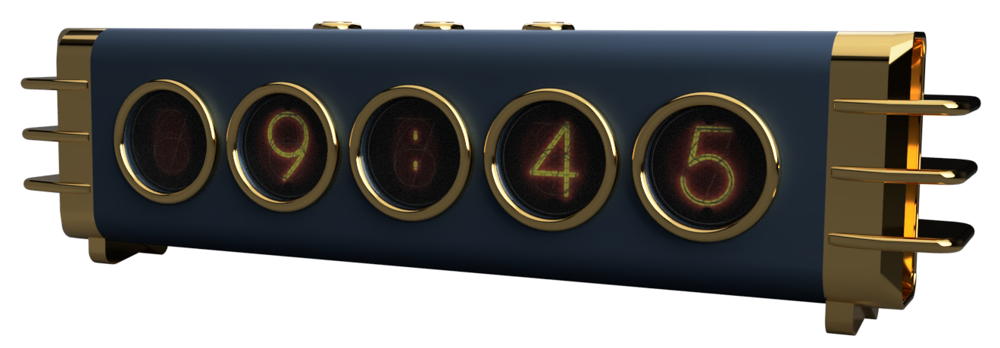

# HoT Info Orbs



## Quick start: no software to install on your PC

About 10 minutes. You need the built orbs, a **USB-C data cable** (many cheap
cables carry power only), a computer with **Google Chrome or Microsoft Edge**
(Safari and Firefox cannot talk to USB devices), and a **2.4 GHz** WiFi
network.

1. Download the firmware, **[`info_orbs_fw_combo.bin`](https://github.com/scottdube/hot-info-orbs/releases/download/firmware-1.7.0/info_orbs_fw_combo.bin)**
   (click it; it goes to your Downloads folder). It is also on the
   [firmware release page](https://github.com/scottdube/hot-info-orbs/releases/tag/firmware-1.7.0)
   under **Assets**, with its checksum.
2. In Chrome or Edge, open
   **[ESPConnect](https://thelastoutpostworkshop.github.io/ESPConnect/)**.
3. Plug the orbs into the computer with the USB cable. Click **Connect** (top
   left), pick the port that appeared when you plugged in, and click
   **Connect** in that box. On a Mac it is usually *USB JTAG/serial debug
   unit*; on Windows, *USB Serial Device (COM3)* or another COM number.
4. In the left column click **Flash Tools**. Under **Flash Firmware**:
   - **Firmware binary (.bin):** choose `info_orbs_fw_combo.bin`
   - **Flash offset:** `0x0`
   - click **Flash firmware** and wait for it to finish.
5. Unplug the USB cable and plug it back in. The orbs restart.
6. **WiFi:** the screens show a network named `Info-Orbs_` and two
   characters. Join it on a phone; a setup page opens (if not, browse to
   `http://192.168.4.1`). Pick your home WiFi and type its password.
7. **Your free weather key and time zone:** the orbs show their **IP
   address** when they join your WiFi. On a phone or computer on the same
   WiFi, browse to `http://<that address>/settings`. The page starts with
   **API keys**: paste a [Visual Crossing](https://www.visualcrossing.com/sign-up)
   key, free and about a minute to get. Under **Time zone and location**,
   pick your time zone from the list (it starts on New York; daylight saving
   is automatic) and set your weather town, then press **Save and restart**.
   Until the key is in, the weather page stays empty; the clock works without
   it. Own a Tempest weather station? Its token goes under **API keys** too
   ([details](docs/USER-GUIDE.md#weather-from-your-own-tempest-stations)).

**Connect finds no port?** Put the XIAO in download mode: unplug, hold the
**B** button on the XIAO, plug back in, let go, and click **Connect** again.
Anything else: [Troubleshooting](docs/TROUBLESHOOTING.md).

**Running? Next:** the [user guide](docs/USER-GUIDE.md) covers the buttons,
the pages, the settings page and what the orbs do when WiFi drops.

## Updating later: over WiFi, no cable

After the first install, new versions go in over WiFi with a second, smaller
file, `firmware.bin`. It replaces only the software and keeps your WiFi, key,
settings and start-up picture.

1. Download **[`firmware.bin`](https://github.com/scottdube/hot-info-orbs/releases/download/firmware-1.7.0/firmware.bin)**.
2. On a phone or computer on the same WiFi, browse to
   `http://<orbs' address>/update` (the address the orbs show at start-up).
3. Choose `firmware.bin` and press **Upload**. The orbs restart on their own
   when it is done, with your WiFi, key and settings kept.

**Update failed, or the orbs stay dark?** Nothing is broken: do the
[Quick start](#quick-start-no-software-to-install-on-your-pc) again. It wipes
the board, so WiFi and the weather key go back in at steps 6 and 7.

Want to change the code, or build it yourself? The [build guide](docs/SETUP.md)
covers that.

## Want a more hands-on install? Start here

**You don't need a GitHub account.** The list of folders above is the
project's files. Pick the link that matches what you want:

| You want to… | Go to |
|---|---|
| see what it is and what it does | the [feature sheet](https://scottdube.github.io/hot-info-orbs/features.html), an ordinary web page |
| get a built one running, nothing to install | the [Quick start](#quick-start-no-software-to-install-on-your-pc) above: download one file, flash it from Chrome |
| learn the buttons, the pages and the settings | the [user guide](docs/USER-GUIDE.md) |
| fix something that looks wrong | [Troubleshooting](docs/TROUBLESHOOTING.md), organized by what you see |
| build the software yourself, or change it | the [build guide](docs/SETUP.md), written for someone who has never done this |
| order a bare board | the [board rev 2.5 release](https://github.com/scottdube/hot-info-orbs/releases/tag/board-rev2.5): gerber zip for the fab, parts list, schematic and board PDFs, 3D model |
| print the enclosure | [hardware/enclosures/](hardware/enclosures/): the Winged Speedster enclosure, one `.3mf` per part (they open in Bambu Studio, PrusaSlicer and Orca Slicer), with [how many of each to print](hardware/enclosures/winged-speedster/README.md#required-components), two Bambu Studio projects and the Fusion source |
| get all the source | the green **Code** button above, then **Download ZIP** |

## What it shows

Each page uses all five displays. Set a rotation time (on the settings page,
or `WIDGET_CYCLE_DELAY` in `config.h`) and the orbs move from page to page on
their own. The left and right buttons step back and forward by hand.
Hold the middle button for 2 seconds to see the orb's own info page:
firmware version, WiFi, address, health and data feeds. It appears while
you are still holding. Any button closes it, or it closes by itself after
2 minutes. The [user guide](docs/USER-GUIDE.md) explains every line on it.

- **Clock**: normal, Nixie-tube, or custom faces, in your choice of colors.
- **Weather** for a town (Visual Crossing), from your own
  [Tempest](https://tempest.earth) weather stations (one page per station),
  or both.
- **Stocks**: five tickers.
- **Custom pages** that you set up from the browser, no rebuild:
  - **Web Data** draws a JSON file from any web address.
  - **MQTT**, up to two pages, shows one live value per display from an MQTT
    broker, such as Home Assistant. Long values wrap, and the orbs on a page
    share one text size.

  See [docs/CUSTOM-PAGES.md](docs/CUSTOM-PAGES.md).

## What you need

**To run it** (the [Quick start](#quick-start-no-software-to-install-on-your-pc)):

- The assembled orbs: carrier board, a XIAO ESP32-S3 or S3 Plus, five GC9A01
  round displays, three buttons.
  **S3 or S3 Plus makes no difference to the software.** Both use the same
  file; there is nothing to change. The Plus has more memory, which the
  software does not use yet.
- A **USB data cable**. Many cheap cables carry power only.
- A **2.4 GHz** WiFi network. The ESP32 cannot see 5 GHz.
- A computer with **Google Chrome or Microsoft Edge**, for the first install
  only. After that a phone is enough.
- One free **API key**. An API key is a code a website gives you when you
  sign up, so the orbs can ask it for data. It takes about a minute:
  [Visual Crossing](https://www.visualcrossing.com/sign-up), for weather.
  Sign up for your own. A shared key uses up one free allowance, and if it is
  cancelled it stops working for everyone using it. The time zone needs no
  key: the firmware carries the daylight-saving rules itself.

**To build the software yourself**, also:

- [VS Code](https://code.visualstudio.com) with the
  [PlatformIO](https://platformio.org) extension, and about 1 GB of free
  disk. Most people never need this.

## Using it

Once the orbs are on your WiFi, everything is done from a web browser on a
phone or computer on the same WiFi. The orbs show their **IP address** on
orb 5 when they join (four numbers with dots, like `192.168.1.57`).

| Address | What it does |
|---|---|
| `http://<IP>/settings` | rotation time, which pages show, tickers, weather location and units, time zone, clock face and colors, night dimming, upside-down mounting, the waking eyes at start-up, what to show when WiFi is out, custom pages, your own start-up picture |
| `http://<IP>/update` | install a new version of the software without a cable. The page also shows which version is running. |

The [user guide](docs/USER-GUIDE.md) has the rest: the buttons, each page,
every section of the settings page, the info page, what the amber and red
marks mean, changing WiFi, running from a phone hotspot, and the log.
[Troubleshooting](docs/TROUBLESHOOTING.md) is organized by what you see.

## Building it yourself

[docs/SETUP.md](docs/SETUP.md) is the full walk-through, about 45 minutes the
first time, written for someone who has never used PlatformIO. You make two
settings files (`config.h` for preferences, `secrets.h` for your keys, neither
ever uploaded to GitHub), install over USB once, and update over WiFi after
that. Building it yourself is also how you set a password on the settings and
update pages, and how you
[give each of several sets its own name](docs/SETUP.md#building-more-than-one-set).

## Hardware

*Mainly for people building or changing the board. If you have a kit, you can
skip this section.*

- **Carrier board:** the KiCad 10 project in
  [hardware/hot-info-orbs-xiao-46mm/](hardware/hot-info-orbs-xiao-46mm/), with
  the displays 46 mm apart to fit the enclosure. Its symbol and footprint
  libraries are inside the project, so you can open it without installing
  anything. Its README has the board's history, the pin map and the BOM; the
  files sent to the fab are in its `fab/`.
- **Enclosure:** 3D-printed, in [hardware/enclosures/](hardware/enclosures/);
  design notes in [docs/ENCLOSURE.md](docs/ENCLOSURE.md).
- **Power:** a USB-C cable into the XIAO. The displays run from 5 V and each
  one lowers it to 3.3 V on its own little regulator chip, so the XIAO stays
  cool.
- **Buying displays:** get the round 1.28" GC9A01 display named in the
  [parts list](hardware/hot-info-orbs-xiao-46mm/bom/). If you buy a different
  one, check two things: its pins are in the order VCC, GND, SCL, SDA, DC, CS,
  RST, and the back of the board has a small regulator chip with a capacitor
  on each side.

*For developers:* older boards are not on `main`, but each one is kept under
a tag (`git checkout <tag> -- <folder>` brings a folder back):

| Tag | What |
|---|---|
| [`board-46mm-rev2.5`](https://github.com/scottdube/hot-info-orbs/releases/tag/board-46mm-rev2.5) | the current board as signed off for the fab, with the zips from every earlier fab run |
| [`board-xiao-narrow-final`](https://github.com/scottdube/hot-info-orbs/releases/tag/board-xiao-narrow-final) | first XIAO carrier, displays ~39 mm apart; never ordered |
| [`v1.1-run1`](https://github.com/scottdube/hot-info-orbs/releases/tag/v1.1-run1) | the v1.1 prototype on an ESP32-S3 SuperMini, the module used before the XIAO |

## Documentation

| | |
|---|---|
| [docs/USER-GUIDE.md](docs/USER-GUIDE.md) | using the orbs: buttons, pages, the settings page, the info page, what the orbs do when WiFi drops |
| [docs/TROUBLESHOOTING.md](docs/TROUBLESHOOTING.md) | what to do, organized by what you see |
| [docs/SETUP.md](docs/SETUP.md) | building the software yourself, from an empty computer |
| [docs/CUSTOM-PAGES.md](docs/CUSTOM-PAGES.md) | Web Data and MQTT pages, with Home Assistant recipes (The Villages town squares among them) |
| [docs/TRAPS.md](docs/TRAPS.md) | problems that each cost time once, written down so they don't again |
| [docs/ENCLOSURE.md](docs/ENCLOSURE.md) | the enclosure design and why it looks the way it does |
| [docs/VARIANT-XIAO-ESP32S3.md](docs/VARIANT-XIAO-ESP32S3.md) | why the XIAO, and how the board's pins were chosen |
| [docs/POWER-MEASURED.md](docs/POWER-MEASURED.md) | measured current draw, and why the displays run on 5 V |
| [docs/REQUIREMENTS.md](docs/REQUIREMENTS.md) | requirements for the settings page and WiFi updates |
| [docs/TEMPEST-API.md](docs/TEMPEST-API.md) | how the Tempest weather data is read |
| [docs/DISPLAY-EDGE-TEST.md](docs/DISPLAY-EDGE-TEST.md) | how much of each round display is usable, measured |
| [docs/VARIANT-ESP32-S3-SUPERMINI.md](docs/VARIANT-ESP32-S3-SUPERMINI.md), [docs/ESPHOME-EVALUATION.md](docs/ESPHOME-EVALUATION.md) | history: the module used before the XIAO, and why this isn't an ESPHome project |

Several of these keep the reasoning behind a decision, not just the decision:
a choice with its argument attached can be revisited without starting over.

## Credit and license

**This is a derivative of [Info Orbs by Brett Turner](https://github.com/brettdottech/info-orbs):
his project, his firmware, his idea.** His repository, its
[contributors](https://github.com/brettdottech/info-orbs/graphs/contributors)
and his [assembly and flashing video](https://link.brett.tech/orbsYT) are where
this came from. If you want the original rather than this variant, his boards
can be [bought as a dev kit](https://brett.tech/collections/electronics-projects/products/info-orbs-full-dev-kit).

The firmware is his, with changes. The board is new: a different
microcontroller and a different power layout. The main differences from
upstream:

| | Upstream | This project |
|---|---|---|
| Microcontroller | ESP32 dev kit | Seeed XIAO ESP32-S3 or S3 Plus |
| Display power | 3.3 V from the module's regulator | 5 V, each display regulates its own |
| API keys | in `config.h` | in `secrets.h`, ignored by git; the build fails without it |
| Settings | edit `config.h`, rebuild, reflash | a settings page in the browser |
| Firmware updates | USB cable every time | over WiFi after the first flash |
| Weather | one Visual Crossing town | also your own Tempest stations |
| Custom pages | one MQTT page, laid out with pixel positions | two MQTT pages and a Web Data page, set up on the settings page |

Licensed **AGPL-3.0**, inherited from upstream (see `LICENSE.txt`). If you give
someone a built orb, they are entitled to its source, which is why this
repository is public.

## Contributing

**Found a problem? Tell us.** If a step in one of the guides is wrong or
unclear, or something went wrong in your build, [open an issue](https://github.com/scottdube/hot-info-orbs/issues)
(a GitHub account is needed; it's free). You can also just tell someone at
the club.

*For developers:* fork the repository and open a pull request. Anyone can
clone, build, fork and propose changes without asking. A build that went wrong is worth reporting even if you already got
around it; that is how [docs/TRAPS.md](docs/TRAPS.md) gets written.

**Push access is by invitation** and kept to a few people. That protects the
board files: GitHub gives a personal repository no read-only collaborator
level, so a collaborator can write everything, including KiCad files, which
git cannot merge.

### For collaborators

```bash
git pull --rebase     # before you start
# ...work...
git commit -am "what changed and why"
git push
```

Run `git config pull.rebase true` once, and a plain `git pull` does the right
thing.

**KiCad files cannot be merged.** If two people edit the same `.kicad_pcb`, one
person's work is lost. So say it out loud first: *"I've got the board"* /
*"it's yours"*. Firmware and docs merge normally.

**Don't edit a KiCad project while KiCad has it open**, scripts included. KiCad
writes its in-memory copy back on save and silently discards anything changed
underneath it.

MegaLinter runs on every push and does **not** commit fixes back, so if the
remote has moved, it was a person, not a bot.
