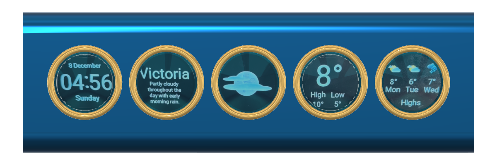

# HoT Info Orbs

Five round 240×240 displays in a row, driven by a Seeed **XIAO ESP32-S3** or
**XIAO ESP32-S3 Plus** on a custom carrier board. They show the time, the
weather, stock prices, and pages you set up yourself, and they rotate through
them on their own.



A [Hands-On Tech Club](https://handsontech.org) build, derived from Brett
Turner's [Info Orbs](https://github.com/brettdottech/info-orbs) (see
[Credit](#credit-and-license)). It is built by people at every skill level, so
the build is meant to be hard to get wrong and cheap to get into.

## Start here

**You don't need a GitHub account.** The list of folders above is the
project's files. Pick the link that matches what you want:

| You want to… | Go to |
|---|---|
| see what it is and what it does | the [feature sheet](https://scottdube.github.io/hot-info-orbs/features.html), an ordinary web page |
| get a built one running | the [setup guide](docs/SETUP.md), written for someone who has never done this |
| order a bare board | the [board rev 2.5 release](../../releases/tag/board-rev2.5): gerber zip for the fab, parts list, schematic and board PDFs, 3D model |
| print the enclosure | [hardware/enclosure/](hardware/enclosure/) |
| get all the source | the green **Code** button above, then **Download ZIP** |

## What it shows

Each page uses all five displays. Set a rotation time (on the settings page,
or `WIDGET_CYCLE_DELAY` in `config.h`) and the orbs move from page to page on
their own. The left and right buttons step back and forward by hand.

- **Clock**: normal, Nixie-tube, or custom faces, in your choice of colors.
- **Weather** for a town (Visual Crossing), or from your own
  [Tempest](https://tempest.earth) weather stations, one page per station.
- **Stocks**: five tickers.
- **Custom pages** that you set up from the browser, no rebuild:
  - **Web Data** draws a JSON file from any web address.
  - **MQTT** shows one live value per display from an MQTT broker, such as
    Home Assistant.

  See [docs/CUSTOM-PAGES.md](docs/CUSTOM-PAGES.md).

## What you need

- The assembled orbs: carrier board, a XIAO ESP32-S3 or S3 Plus, five GC9A01
  round displays, three buttons.
  **S3 or S3 Plus makes no difference to the software.** Both use the same
  file and the same Upload button; there is nothing to change. The Plus has
  more memory, which the software does not use yet.
- A **USB data cable**. Many cheap cables carry power only.
- A **2.4 GHz** WiFi network. The ESP32 cannot see 5 GHz.
- A computer with [VS Code](https://code.visualstudio.com) and the
  [PlatformIO](https://platformio.org) extension.
- Two free **API keys**. An API key is a code a website gives you when you
  sign up, so the orbs can ask it for data. Each takes about a minute:
  [Visual Crossing](https://www.visualcrossing.com/sign-up) for weather and
  [TimeZoneDB](https://timezonedb.com/register) for daylight-saving changes.
  Sign up for your own. A shared key uses up one free allowance, and if it is
  cancelled it stops working for everyone using it.

## Getting it running

[docs/SETUP.md](docs/SETUP.md) is the full walk-through, about 45 minutes the
first time, and ends with a troubleshooting table organized by what you
actually see. In short:

1. **Make your two settings files.** In VS Code, open the `firmware/config`
   folder. Copy `config.h.template` and paste it into the same folder, then
   rename the copy to `config.h` (delete `.template` from the name). Do the
   same to make `secrets.h` from `secrets.h.template`. Then open each new file
   and fill it in: `config.h` holds your preferences (timezone, units, stock
   tickers), `secrets.h` your API keys. [SETUP step 3](docs/SETUP.md#3-create-your-two-config-files)
   has the details.
   Your copies are never uploaded to GitHub, so your keys stay private.
   **The build stops with an error if either file is missing or a key is
   empty.** That is on purpose: otherwise you get a blank orb and no clue why.
2. **Install the software over USB, once.** Installing the orbs' software is
   called *flashing*. Plug the orbs into your computer, then in VS Code click
   the PlatformIO icon (the alien head) on the left, and under *Project Tasks →
   xiao-esp32s3 → General* click **Upload**. The first time has to be over USB;
   after that, updates go over WiFi.
3. **Connect it to WiFi.** The orbs start their own WiFi network, named
   `Info-Orbs_` plus two characters shown on the screens. Join that network
   from a phone, and a page opens where you pick your home network and type its
   password. When the orbs join your network, **they show their IP address
   on screen** (four numbers with dots, like `192.168.1.57`). Write it down:
   it is how you reach them from a browser.

After that, you can do everything from a web browser on a phone or computer
connected to the same WiFi. Type the address with the orbs' IP address in
place of `<IP>`, for example `http://192.168.1.57/settings`.
`http://info-orbs.local/settings` often works too, without the number. (If
you have more than one set, see [Building more than one
set](#building-more-than-one-set).)

| Address | What it does |
|---|---|
| `http://<IP>/settings` | rotation time, tickers, weather location and units, timezone, clock face and colors, night dimming, upside-down mounting, custom pages, your own start-up picture. What you typed in `config.h` is only the starting point. |
| `http://<IP>/update` | install a new version of the software without a cable: choose the file `.pio/build/xiao-esp32s3/firmware.bin` from the project folder and upload it. The page also shows which version is running. |

**Set a password.** Without one, anyone on your WiFi can change your orbs'
settings or install software on them. In `secrets.h`, find the line
`//#define OTA_PASSWORD ""`, delete the `//` at its start, type a password
between the quotes, save, and upload again (step 2). The browser then asks
for user name `admin` and that password.

## Building more than one set

Many members build several. Each set keeps its own WiFi network, settings-page
choices and start-up picture inside itself, so you set each one up on its own.
You can use the same API keys and the same `config.h` and `secrets.h` for all
of your own sets. Each set uses the keys' free daily allowance separately.

**WiFi: one at a time, or not at all.** Each new set starts its own setup
network, `Info-Orbs_` plus two characters. Two sets can end up with the same
two characters, so set them up one at a time. To skip the setup network
altogether, put your WiFi name and password in `secrets.h` before you flash:
find `//#define WIFI_SSID` and `//#define WIFI_PASS`, delete the `//` from
both, and fill them in. Every set you flash then joins that network by itself.

**Names: give each set its own.** Every set is called `info-orbs` unless you
change it, and only one of them can answer to `info-orbs.local`. Before you
flash a set, open `config.h`, find `//#define OTA_HOSTNAME "info-orbs"`,
delete the `//`, and change the name, for example to `"orb-office"`. That set
is then at `http://orb-office.local/settings`, and your router lists it under
that name. The IP address shown on its screen always works too.

**The name is built into the software file, so watch it when updating.** The
name in `config.h` when you build is the name the set gets. If you build once
and upload the same file to two sets, they both end up with the same name.
To update several sets, change the name in `config.h`, build, upload to that
set, and repeat for the next one.

**Optional: update from PlatformIO by name.** Settings that belong to your
computer, such as which USB port to upload to or which set to update over
WiFi, go in a file named `platformio_local.ini` next to `platformio.ini`.
Create it only if you need it; it stays on your computer and is never uploaded
to GitHub. For example, so that *Upload* in the `ota` task updates
`orb-office`:

```ini
[env:ota]
upload_port = orb-office.local
```

## Hardware

*Mainly for people building or changing the board. If you have a kit, you can
skip this section.*

- **Carrier board:** the KiCad 10 project in
  [hardware/hot-info-orbs-xiao-46mm/](hardware/hot-info-orbs-xiao-46mm/), with
  the displays 46 mm apart to fit the enclosure. Its symbol and footprint
  libraries are inside the project, so you can open it without installing
  anything. Its README has the board's history, the pin map and the BOM; the
  files sent to the fab are in its `fab/`.
- **Enclosure:** 3D-printed, in [hardware/enclosure/](hardware/enclosure/);
  design notes in [docs/ENCLOSURE.md](docs/ENCLOSURE.md).
- **Power:** a USB-C cable into the XIAO. The displays run from 5 V and each
  one lowers it to 3.3 V on its own little regulator chip, so the XIAO stays
  cool.
- **Buying displays:** get the round 1.28" GC9A01 display named in the
  [parts list](hardware/hot-info-orbs-xiao-46mm/bom/). If you buy a different
  one, check two things: its pins are in the order VCC, GND, SCL, SDA, DC, CS,
  RST, and the back of the board has a small regulator chip with a capacitor
  on each side.

*For developers:* older boards are not on `main`, but each one is kept under
a tag (`git checkout <tag> -- <folder>` brings a folder back):

| Tag | What |
|---|---|
| [`board-46mm-rev2.5`](../../releases/tag/board-46mm-rev2.5) | the current board as signed off for the fab, with the zips from every earlier fab run |
| [`board-xiao-narrow-final`](../../releases/tag/board-xiao-narrow-final) | first XIAO carrier, displays ~39 mm apart; never ordered |
| [`v1.1-run1`](../../releases/tag/v1.1-run1) | the v1.1 prototype on an ESP32-S3 SuperMini, the module used before the XIAO |

## Documentation

| | |
|---|---|
| [docs/SETUP.md](docs/SETUP.md) | from an empty computer to running orbs |
| [docs/CUSTOM-PAGES.md](docs/CUSTOM-PAGES.md) | Web Data and MQTT pages, with a Home Assistant recipe |
| [docs/TRAPS.md](docs/TRAPS.md) | problems that each cost time once, written down so they don't again |
| [docs/ENCLOSURE.md](docs/ENCLOSURE.md) | the enclosure design and why it looks the way it does |
| [docs/VARIANT-XIAO-ESP32S3.md](docs/VARIANT-XIAO-ESP32S3.md) | why the XIAO, and how the board's pins were chosen |
| [docs/POWER-MEASURED.md](docs/POWER-MEASURED.md) | measured current draw, and why the displays run on 5 V |
| [docs/REQUIREMENTS.md](docs/REQUIREMENTS.md) | requirements for the settings page and WiFi updates |
| [docs/TEMPEST-API.md](docs/TEMPEST-API.md) | how the Tempest weather data is read |
| [docs/DISPLAY-EDGE-TEST.md](docs/DISPLAY-EDGE-TEST.md) | how much of each round display is usable, measured |
| [docs/VARIANT-ESP32-S3-SUPERMINI.md](docs/VARIANT-ESP32-S3-SUPERMINI.md), [docs/ESPHOME-EVALUATION.md](docs/ESPHOME-EVALUATION.md) | history: the module used before the XIAO, and why this isn't an ESPHome project |

Several of these keep the reasoning behind a decision, not just the decision:
a choice with its argument attached can be revisited without starting over.

## Credit and license

**This is a derivative of [Info Orbs by Brett Turner](https://github.com/brettdottech/info-orbs):
his project, his firmware, his idea.** His repository, its
[contributors](https://github.com/brettdottech/info-orbs/graphs/contributors)
and his [assembly and flashing video](https://link.brett.tech/orbsYT) are where
this came from. If you want the original rather than this variant, his boards
can be [bought as a dev kit](https://brett.tech/collections/electronics-projects/products/info-orbs-full-dev-kit).

The firmware is his, with changes. The board is new: a different
microcontroller and a different power layout. The main differences from
upstream:

| | Upstream | This project |
|---|---|---|
| Microcontroller | ESP32 dev kit | Seeed XIAO ESP32-S3 or S3 Plus |
| Display power | 3.3 V from the module's regulator | 5 V, each display regulates its own |
| API keys | in `config.h` | in `secrets.h`, ignored by git; the build fails without it |
| Settings | edit `config.h`, rebuild, reflash | a settings page in the browser |
| Firmware updates | USB cable every time | over WiFi after the first flash |
| Weather | one Visual Crossing town | also your own Tempest stations |

Licensed **AGPL-3.0**, inherited from upstream (see `LICENSE.txt`). If you give
someone a built orb, they are entitled to its source, which is why this
repository is public.

## Contributing

**Found a problem? Tell us.** If a step in the setup guide is wrong or
unclear, or something went wrong in your build, [open an issue](../../issues)
(a GitHub account is needed; it's free). You can also just tell someone at
the club.

*For developers:* fork the repository and open a pull request. Anyone can
clone, build, fork and propose changes without asking. A build that went wrong is worth reporting even if you already got
around it; that is how [docs/TRAPS.md](docs/TRAPS.md) gets written.

**Push access is by invitation** and kept to a few people. That protects the
board files: GitHub gives a personal repository no read-only collaborator
level, so a collaborator can write everything, including KiCad files, which
git cannot merge.

### For collaborators

```bash
git pull --rebase     # before you start
# ...work...
git commit -am "what changed and why"
git push
```

Run `git config pull.rebase true` once, and a plain `git pull` does the right
thing.

**KiCad files cannot be merged.** If two people edit the same `.kicad_pcb`, one
person's work is lost. So say it out loud first: *"I've got the board"* /
*"it's yours"*. Firmware and docs merge normally.

**Don't edit a KiCad project while KiCad has it open**, scripts included. KiCad
writes its in-memory copy back on save and silently discards anything changed
underneath it.

MegaLinter runs on every push and does **not** commit fixes back, so if the
remote has moved, it was a person, not a bot.
