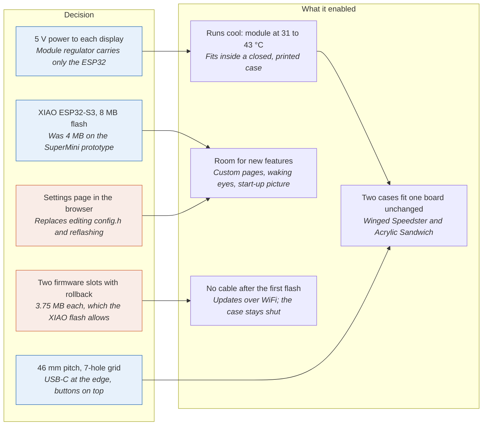
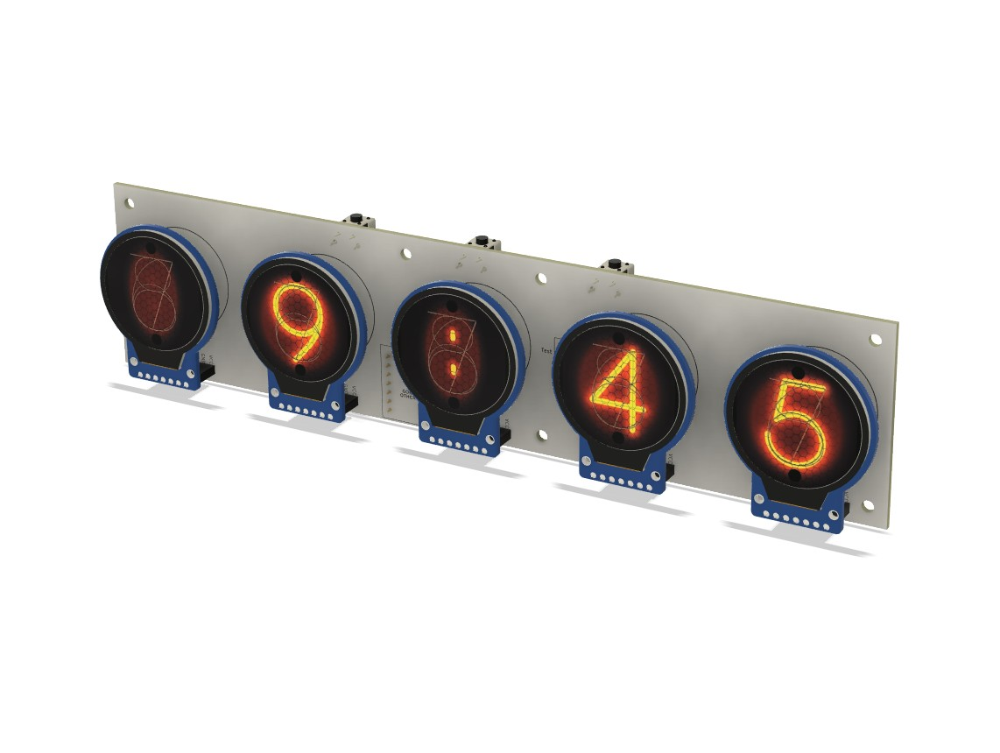
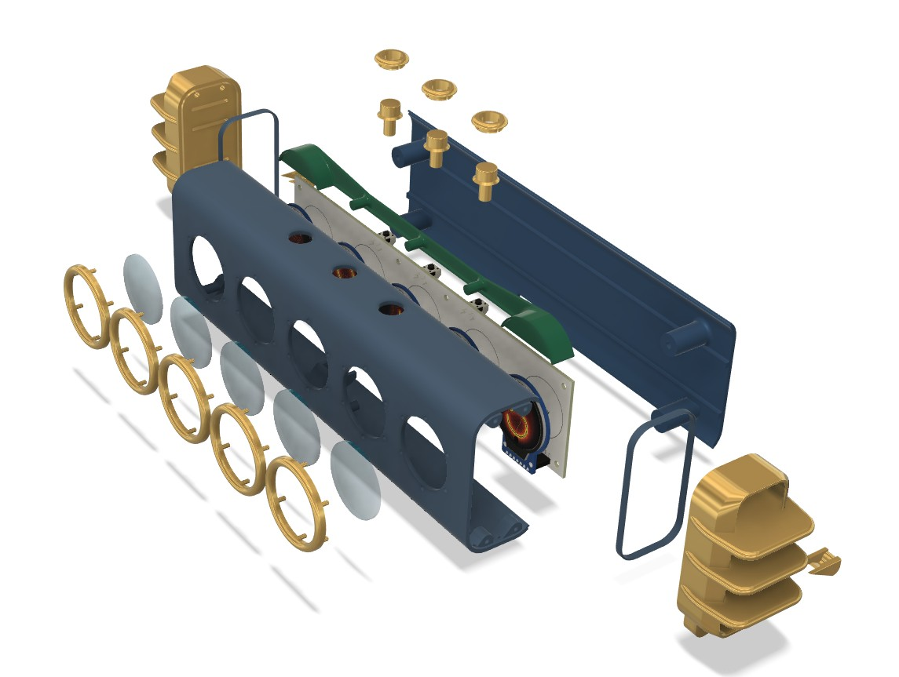
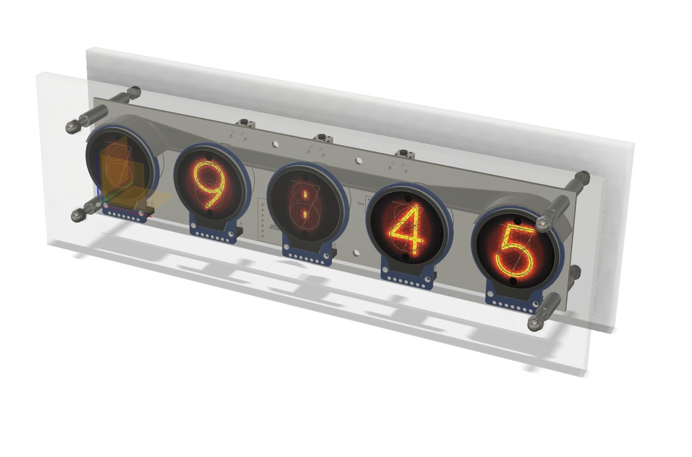

# HOT Info Orbs — Design History and Decisions

16 November 2026 · Yang

In under three months, starting 27 August 2026, the Hands-On Tech Club turned Brett Turner's Info Orbs into a club kit: a new carrier board, two enclosures, and firmware that is set up and updated from a browser. This paper records the major decisions and how each one opened the way for later work.

## Origin

[Info Orbs](https://github.com/brettdottech/info-orbs) is Brett Turner's open-source desk display: five 1.28 in GC9A01 round screens on one SPI bus, showing a clock, weather and stocks. Brett published it in April 2024, and a community of contributors grew the firmware from there. The club forked the original design's main branch as of February 2025, and its first commits landed on 27 August 2026.

The original design worked, but three things made it a poor fit for a club kit:

- **Power.** All five displays ran from the ESP32 module's own 3.3 V regulator. That is a 1 A AMS1117 on Brett's dev kit, but a much smaller part on the ESP32-S3 SuperMini, the module the HackerBox 0129 kit (a SuperMini version of the same design) and the club's first prototype used. HackerBox builders saw it: one reported 82 °C with the radio off, and Donald Champion's kit measured 88.5 °C.
- **Configuration.** Every change, including API keys, meant editing `config.h`, rebuilding and reflashing over USB.
- **Hardware.** A two-layer board for a 30-pin ESP32 dev kit, sized for the module rather than for an enclosure.

**The goal set the rules for every decision that followed:** a kit that is hard to get wrong and cheap to start, which works for a member who has nothing but a WiFi router. That last rule is why the project is not an ESPHome build: Home Assistant owners get MQTT pages as an option, not a requirement.

| | Original Info Orbs design | HOT Info Orbs |
| --- | --- | --- |
| Microcontroller | ESP32 dev kit | Seeed XIAO ESP32-S3 or S3 Plus |
| Display power | 3.3 V from the module's regulator | 5 V; each display regulates its own |
| Settings | Edit `config.h`, rebuild, reflash | Settings page in a browser |
| Firmware updates | USB cable every time | Over WiFi after the first flash, with rollback |
| API keys | In `config.h` | In git-ignored `secrets.h` or the settings page |
| Enclosure | A stand made as a second KiCad board (StandOrbs) | Winged Speedster (printed), Acrylic Sandwich |

The firmware is still Brett's at its core, licensed AGPL-3.0, and the club's changes stay public under that license.

## How the decisions connect

Each decision removed a limit that later work would have hit.

*Blue: PCB decisions. Orange: software decisions.*

The 5 V power change and the board's fixed geometry made the enclosures possible; the XIAO's flash made the software features possible.

## PCB hardware

The board went through three generations in two months: a v1.1 prototype on an ESP32-S3 SuperMini, a narrow XIAO carrier that was never ordered, and the 46 mm XIAO carrier at rev 2.5 that is the kit today. Yang and Scott designed it in KiCad 10.

### Decision 1: power each display from 5 V

The first fix was the one that had burned builders. The original design fed all five displays from the module's 3.3 V regulator. On Brett's ESP32 dev kit that regulator is an AMS1117 rated 1 A, in a SOT-223 package. The club's first prototype used an ESP32-S3 SuperMini, as the HackerBox 0129 kit does, and the SuperMini's regulator is an ME6211-series part in a much smaller SOT-23-5 package. Fed the same way, at the measured load it would drop (5.0 − 3.3) V × 342 mA = 581 mW, for an estimated junction of 112–170 °C, at or past thermal shutdown.

That is what HackerBox builders were seeing. One reported 82 °C with the radio off, and Scott's thermal shots of Donald Champion's HackerBox 0129, with its displays on the SuperMini's 3.3 V, read 86.6–88.5 °C at the module's hottest point on 27 October 2026, while the display backs stayed at about 24 °C. The 82 °C and 88.5 °C readings are SuperMini readings, not readings of Brett's dev kit.

The GC9A01 modules each carry their own regulator, so the club wired 5 V straight to each display. The module's regulator now powers only the ESP32.

- **Measured on the v1.1 prototype (Nordic PPK II):** 342 mA (1.71 W) typical, 1.15 A at power-on. Hottest point on the module about 43 °C.
- **Measured on the XIAO, 16 Nov 2026:** about 305 mA (1.53 W) and a 770–781 mA inrush. Module 31.4 °C in a 20.7 °C room after about 21 minutes.

**What it enabled:** a thumbnail-sized controller whose small regulator only has to carry the ESP32, and an electronics package cool enough to close inside a printed plastic case.

### Decision 2: the v1.1 prototype on an ESP32-S3 SuperMini

The SuperMini was first declined on cost and complexity on 27 August, then reopened at Yang's request once the 5 V change removed the power objection. The same review found that the original design's 56 vias were self-inflicted: the circuit is planar. Ten v1.1 boards were ordered on 29 August 2026.

The prototype proved the 5 V power design and gave the first real power numbers. It also exposed the next limit: **4 MB of flash.** Two over-the-air (OTA) slots of 1.875 MB each left the firmware 85.9% full of a slot, with no room to grow.

### Decision 3: the Seeed XIAO ESP32-S3 carrier

On 14 October the carrier was reworked for the XIAO ESP32-S3, a copy of the v1.1 board with the module swapped, rather than an adapter on the old board.

- **8 MB flash.** Two 3.75 MB firmware slots. The same firmware that filled 85.9% of a SuperMini slot now uses about 43–49%.
- **S3 or S3 Plus, one binary.** Both share the same edge pins, LED, size and 8 MB PSRAM. The Plus adds flash (16 MB), which the firmware does not use yet.
- **11 GPIO, not 12.** The display reset line moved off the MCU onto an RC power-on reset (10 kΩ, 1 µF) plus software reset. This works in simulation; it has not been measured on hardware.
- **Headers or castellations.** The footprint takes the module on 2.54 mm headers or soldered flat.

**What it enabled:** room to grow. The settings page, OTA updates and Tempest weather were built on the SuperMini in September, and keeping them in a 4 MB slot meant dropping a font and re-compressing images. The XIAO's headroom is what the later features live in: custom MQTT and web pages, the start-up eyes, and a 384 KB filesystem for an uploaded start-up picture.

### Decision 4: a board built to be assembled, repaired and enclosed

On 16–17 October the board's physical layout was reworked for builders, not just for the circuit.

- **Sockets.** The five displays and the XIAO plug into female headers, so a bad part is swapped, not desoldered.
- **Buttons on the top edge.** Right-angle switches point up, out past the board.
- **One component side.** The capacitors, resistor and switches sit on the back with the XIAO, leaving the front for the displays.
- **Seven mounting holes,** each 5 mm from an edge.
- Pre-fab review also connected the fifth display's DC line, moved a button off a strapping pin and added a ground pour.

### Decision 5: the 46 mm board, shaped by the enclosure

On 19 October the board was copied and changed to fit the enclosure, not the other way round.

- **46 mm display pitch** (was about 39 mm) to match the bezel spacing of the enclosure front. The board grew from 198.82 mm to 224.0 mm wide.
- **Grown 5 mm at the top** (rev 2.1) so the top mounting holes land on enclosure posts instead of under the case lip.
- **XIAO moved 4 mm down** (rev 2.3) so the USB-C jack reaches the board edge, where a case can expose it.
- **Labels for beginners** (rev 2.4): display designators on the back silk and a "Display" circle at each position on the front.
- **Test pads** (rev 2.5): 3V3, GND and 5V on a 2.54 mm column, for debugging other people's builds. They are bare pads, so the kit cost does not change.

*The 46 mm carrier with displays fitted (Fusion render). Buttons point up from the top edge; the seven mounting holes sit 5 mm in from the edges.*

Thirty rev 2.5 boards were ordered on 25 October 2026. JLCPCB's design rules are loaded into the DRC, the libraries are project-local, and the gerbers for every fab run are archived under the `board-46mm-rev2.5` tag.

## Enclosures

The original design had no case beyond a stand. The new board was shaped so the club could build several very different enclosures around one set of electronics. Two exist today, designed in Autodesk Fusion against the board's exported STEP model.

### What the board gives an enclosure designer

| Board feature | What the enclosure gets |
| --- | --- |
| Displays parallel to the PCB at a fixed 46 mm pitch | A flat front plate with five bezel holes on a simple pattern |
| Seven mounting holes, each 5 mm from an edge | Posts and screws on a known grid; the Acrylic Sandwich uses only the outer four |
| Buttons on the top edge, actuators pointing out | Buttons on top of the case, with nothing under the displays |
| USB-C jack at the board edge | One cable cut-out or panel notch, no internal extension |
| All other parts on the back face | A clean front and a shallow body |
| A cool controller (5 V display power) | A closed plastic case around a module measured at 31–43 °C, not 82 °C |
| An accurate STEP model from KiCad | Fit checked in CAD before printing; interference checks came back clean |

### Winged Speedster (3D printed)

Chosen on 17 October 2026 from three concepts: a Jet Age bar with a dark blue-grey body, a brass ring around each display, and finned brass wings. The concept showed buttons under the displays; they moved to the top because the board already put them there.

The design and the board grew together:

- A **front mock-up** (19 October) dropped over the narrow board and showed the bezel spacing the board should match. The 46 mm board followed the same day.
- The **bezel opening is 32.5 mm**, measured in a display-edge test so the ring shows every pixel and none of the dark glass border.
- The board hangs on **seven posts** from the front body. Buttons pass through the top lip with printed plungers bridging a 12.9 mm gap.
- The Fusion model is a **master assembly**. The left and right wings come from one shared source sketch, so one edit updates both, the assembly and the exploded view.

The finished files went in on 12 November 2026: one `.3mf` per part, two Bambu Studio projects and the Fusion archive. A kit prints a front and back body, five display bezels, three buttons and button bezels, a display standoff, two joint sleeves, two wings and two optional rear heels (fit them if you do not want the displays tilted). The prototypes used matte Army Blue PLA for the body and silk Gold PLA for the trim.

Fasteners were settled the same way as the board: by measuring. Boss depth was checked in Fusion for each screw path, which showed one length engages better everywhere than two. Each kit uses **15 #4 × 3/8 in Phillips pan-head screws**; 600 were ordered on 9 November 2026 for a 40-kit run, about $0.58 a kit landed.

*Winged Speedster, exploded view of the master assembly.*

### Acrylic Sandwich

A minimal open-frame case. The board is clamped between two 6.35 mm (1/4 in) clear acrylic panels, 254.00 × 82.78 mm, on four M3 threaded rods through the board's outer mounting holes. Aluminum spacers (15 mm in front, 16 mm behind) set the gaps and cap nuts close each end.

- The panels are **cut by a plastics shop**, not printed, because clear, flat, polished acrylic is what lets the displays show through. The folder has fabrication drawings (PDF) and DXF cut files.
- The back panel has a 15 × 17 mm notch for the USB cable. An optional front panel has five 35.5 mm display openings.
- The only printed part is a display standoff, glued to the board.
- The Fusion file is self-contained, so others can change it without the Winged Speedster files.

*Acrylic Sandwich: the same board between two clear panels on four rods (Fusion render).*

**The two cases share no parts, yet both fit the same board unchanged.** That is the payoff of designing the board to a fixed pitch, hole pattern and connector edge.

## Software

The firmware's direction came from one rule: after the first flash, a member should never need a cable, a compiler or a text editor. Releases 1.2.0 to 1.8.0 shipped between 9 and 14 November 2026, built with PlatformIO on the Arduino ESP32 core.

### Decision 1: secrets out of the source (27 August)

API keys moved from `config.h` into a git-ignored `secrets.h`, and later onto the settings page. The build fails if a key is missing, so a blank orb is caught at compile time rather than on someone's desk. This was the club's first commit, and it made a public repository safe to share.

### Decision 2: a settings page instead of `config.h`

A page at `/settings` covers rotation time, tickers, weather town, units, time zone, clock face and colors, night hours, visible pages and mounting. Settings persist across restarts and updates; `config.h` now only supplies defaults. Fields are validated before saving.

**What it enabled:** every later feature (Tempest stations, MQTT pages, eye styles, a start-up picture) is configured here with no rebuild.

### Decision 3: updates over WiFi, with rollback

The partition table was reworked for two firmware slots. An update writes the idle slot, and the new image is confirmed only after it reaches WiFi; otherwise the orb boots the old one. Uploads take about 11 seconds, and the orb is back online about 14 seconds later.

**What it enabled:** a kit that is flashed once over USB and then lives inside its case. Combined with the browser-based first flash (ESPConnect in Chrome or Edge), a member needs no software on their computer at all. This decision is also what made flash size the hardware constraint that led to the XIAO.

### Decision 4: behave well when WiFi fails

A club kit runs on home networks nobody can debug remotely, so outages got their own design.

- Stale data is marked with an amber ring; an optional outage mode shows the clock with a red ring.
- The orb retries every 30 seconds, never restarts during an outage, and resets its radio after 2.5 minutes.
- Start-up failures are named on screen: never set up, network not found, or wrong password (reported in about 18 seconds).
- A device log at `/log` and a hold-the-middle-button info screen help members and helpers diagnose problems. The log never stores network names, passwords or keys.

### Decision 5: more data sources, without making any of them required

- **Tempest weather stations** (up to two). A filter cuts the 96 KB API reply to 744 bytes, which keeps memory use low.
- **Custom pages:** two MQTT pages, for example from Home Assistant, and a JSON page that reads any web address. Text is measured and wrapped to up to three lines.
- Each is optional. The orbs still work with nothing but a router and a free Visual Crossing key, which is why ESPHome was ruled out.

### Decision 6: let the hardware's limits shape the features

- **Night mode.** The displays' backlight-control pin is not connected on these modules (tested 25 September 2026). So the firmware offers dim and screens-off schedules: panels sleep and go blank but still glow, and true black needs a switch on the 5 V feed.
- **Display reset.** With 11 GPIO on the XIAO, there is no reset line; the firmware uses a software reset.
- **Upside-down mounting.** One setting flips the screens and reverses their order, for a set mounted the other way up. The buttons keep their physical meaning.

### Decision 7: personality and polish

The start-up "waking eyes" open on orbs 2 and 4 while WiFi connects, look around while data loads, and go cross-eyed if WiFi fails. There are eleven eyelid styles and nine iris colors. Members can also upload their own start-up picture, which the browser crops to 240 × 240.

### Quality

313 unit tests run locally and in CI, plus 28 browser-side tests for the version check. A linter reports but never auto-commits. A setup guide and a "traps" file record the mistakes that each cost time once. An uninitialized loop counter in the original design's page rotation was found and fixed along the way.

## Timeline

| Date | Area | Milestone |
| --- | --- | --- |
| Apr 2024 | Original design | Brett Turner publishes Info Orbs |
| Feb 2025 | Original design | Fork point: the original design's main branch |
| 27 Aug 2026 | Software | Club's first commit: keys moved to `secrets.h`; SuperMini evaluated |
| 28 Aug 2026 | PCB | Display rail corrected: displays move to 5 V |
| 29 Aug 2026 | PCB | Ten v1.1 SuperMini boards ordered |
| 10 Sep 2026 | PCB | Power measured: 342 mA typical, 1.15 A at power-on |
| 23–24 Sep 2026 | Software | Settings page and Tempest weather designed |
| 14 Oct 2026 | PCB | XIAO ESP32-S3 carrier started |
| 17 Oct 2026 | Enclosure | Winged Speedster style chosen; custom pages designed |
| 19 Oct 2026 | PCB, Enclosure | 46 mm board created to match the enclosure front |
| 20 Oct 2026 | Enclosure | Enclosure design handed to Yang |
| 25 Oct 2026 | PCB | Rev 2.5 with test pads; 30 boards ordered |
| 9 Nov 2026 | Enclosure, Software | Screws ordered for 40 kits; firmware 1.2.0 released |
| 10 Nov 2026 | Software | Waking eyes designed |
| 12 Nov 2026 | Enclosure | Finished Winged Speedster print files published |
| 14 Nov 2026 | Software | Firmware 1.8.0 released |
| 16 Nov 2026 | PCB | XIAO power and temperature measured |

## Sources

All from the project repository, [github.com/scottdube/hot-info-orbs](https://github.com/scottdube/hot-info-orbs), read 16 November 2026:

- [Feature and spec sheet](https://scottdube.github.io/hot-info-orbs/features.html)
- [README](https://github.com/scottdube/hot-info-orbs/blob/main/README.md)
- [Board design history (46 mm carrier)](https://github.com/scottdube/hot-info-orbs/blob/main/hardware/pcb/HISTORY.md)
- [VARIANT-XIAO-ESP32S3.md](https://github.com/scottdube/hot-info-orbs/blob/main/docs/VARIANT-XIAO-ESP32S3.md) and [VARIANT-ESP32-S3-SUPERMINI.md](https://github.com/scottdube/hot-info-orbs/blob/main/docs/VARIANT-ESP32-S3-SUPERMINI.md)
- [POWER-MEASURED.md](https://github.com/scottdube/hot-info-orbs/blob/main/docs/POWER-MEASURED.md)
- [ENCLOSURE.md](https://github.com/scottdube/hot-info-orbs/blob/main/docs/ENCLOSURE.md)
- [Winged Speedster README](https://github.com/scottdube/hot-info-orbs/blob/main/hardware/enclosures/Winged-Speedster/README.md) and [Acrylic Sandwich README](https://github.com/scottdube/hot-info-orbs/blob/main/hardware/enclosures/Acrylic-Sandwich/README.md)
- [ESPHOME-EVALUATION.md](https://github.com/scottdube/hot-info-orbs/blob/main/docs/ESPHOME-EVALUATION.md)
- `partitions.csv`, git history and release tags
- Original design: [brettdottech/info-orbs](https://github.com/brettdottech/info-orbs)
