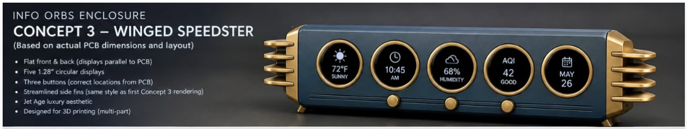
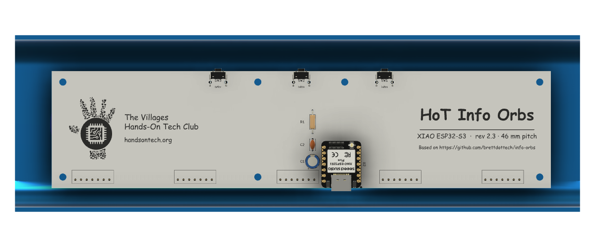

# Enclosure

## Chosen style: Concept 3, "Winged Speedster" (2026-10-17)

This is a concept rendering, not a model. It sets the look the design aims for:

- A Jet Age bar: dark blue-grey body, a brass ring bezel around each display,
  and finned brass end caps.
- Flat front and back, with the five 1.28" displays parallel to the PCB.
- Designed for 3D printing in several parts.

**Change from the rendering: the three buttons move to the top.** The rendering
shows them on the front, under the displays. The XIAO carrier board
(`hardware/hot-info-orbs-xiao/`, branch `xiao-esp32s3-plus`) already puts its
right-angle switches on the top edge, so the board needs no change for this.

**2026-10-19: the board going to the fab is `hardware/hot-info-orbs-xiao-46mm/`**
(branch `board-46mm-pitch`): the same carrier with the five displays at
46.0 mm center to center to match `main_body_front`, 224.0 x 52.78 mm (grown
5 mm at the top the same day, see below), **rev 2.1**. The front mock-up in
`hardware/enclosure/front-mockup-v1/` was built on the narrow 38.98 mm board.

**2026-10-20: rev 2.3** (`tools/lower_xiao.py`) moves the XIAO **4 mm toward the
bottom edge** so the USB-C jack reaches past the board edge, and pulls
C1/C2/R1 in beside its socket. Same outline, same seven holes, same display
and switch positions, so the bezels and posts are untouched. `overall
assembly` **v7** holds the rev 2.3 STEP (same transform as below, the 2.1
occurrence deleted, pose captured as Position5; the decals and discs were
not touched). It was the run 2 STEP; **v8** (same evening) holds the
**rev 2.4** STEP (`tools/display_marks.py`: a Ø29.5 front-silk circle with
the word Display at each module position, rev bumped for it), same
transform, Position6, and keeps the bezel and watch-crystal occurrences
that were in the session unsaved. **`main_body_front` v4 has no USB cutout.** Its timeline is
plate, walls, fillet, three button holes, posts and pins, and the second
`main_body_front` file in the project root is plate, walls and fillet only.
Earlier wording here, in the board README and in `lower_xiao.py` said the
cutout was "4 mm off": that assumed one existed; nobody had looked. Where
the jack now sits is under *The board in the enclosure*.

## Inputs already measured

| What | Value | Source |
|---|---|---|
| Bezel opening (lit area) | **~32.5 mm** dia; shows every pixel | [DISPLAY-EDGE-TEST.md](DISPLAY-EDGE-TEST.md) |
| Dark glass band outside it | ~1.5 mm, even all round, no pixels under it | same |
| Module pocket | the GC9A01 STEP model, caliper-checked by Scott | `hardware/hot-info-orbs/lib/3d/_Displays/` |

A bezel opening wider than ~32.5 mm shows the black band inside the brass ring.

## Front mock-up v1 (2026-10-19)

A printable front that drops over the real board: a face plate plus five
separate bezel rings (37 mm OD, 32.5 mm window). Its top and bottom margins are
equal, 29.135 mm. The interference check against the board STEP is clean. See
[hardware/enclosure/front-mockup-v1/](../hardware/enclosure/front-mockup-v1/README.md).

## The board in the enclosure (2026-10-19)

`overall assembly` **v8** holds the rev 2.4 board STEP
(`hardware/hot-info-orbs-xiao-46mm/3d-assembly/`) on `main_body_front` **v4**
(v4 to v6 carried rev 2.1, v7 rev 2.3). Both are Fusion cloud versions; the STEP is the
source of the board.

**Transform.** Import the STEP into the assembly, rotate +90° about world X,
then translate (−25.99, 17.6, 118.415) mm. World x = board x − 25.99, world
z = 118.415 − board y; the board's back face is at world y 17.6 and its
front at 16.0. The occurrence is left free (not grounded): grounding resets
a free move. The pose is captured as a Position marker.

**Where things land.** Enclosure front at y 0, plate inner face at y 2; the
display glass tops out at y ≈ 2.29, so it sits 0.29 mm behind the plate,
touching nothing. Bezel holes r 17.75 at x 32.75 + n·46, z 37.75; display N
→ world x: 1→78.75, 2→124.75, 3→216.75, 4→170.75, 5→32.75 (the KiCad DS
order is not left-to-right). Module rims r 19.05. Top lip inner z 75.5,
outer 77.5.

**Standoffs.** Ø6 posts from the plate inner face to the board front (y
1.5→16, 14.5 long) and Ø2.9 pins through the board (y 3.5→18.2) on **all
seven** mounting holes, world (x, z): top row z 56.415 at x 16.05 / 103.55 /
142.55 / 230.05, bottom row z 13.635 at x 16.05 / 142.55 / 230.05. Post
clearance to the outer display rims 25.0 mm (left) / 22.9 mm (right). The
v3 enclosure had corner hangers at the top instead of end posts, because
the X0.2 board's top holes sat under the lip; growing the board 5 mm put
them where a post fits, and the hangers (and the Ø2.9 pins that had been
floating inside them as Body2/Body3) are gone. One body.

**USB-C jack (rev 2.3, measured in the assembly).** Port mouth centered at
world x 105.12, y 31.29; its face at z 7.26, 1.38 mm past the board edge
(8.635). The bottom wall's inner face is z 0 and its outer face z −2, flat
from y 14 to 40 (the r12 front fillet ends at y 14), so the jack is 7.3 mm
inside the wall. No cutout exists yet; one would go in that flat at
x 105.1 / y 31.3 and has to pass a plug overmold 7.3 mm deep to the jack.

**Buttons.** Three Ø8 holes 3 mm deep in the top lip over the switch
actuators (x 85.721 / 123.055 / 160.388, actuator y 21.185). The actuator
tops are at z 62.575, 12.9 mm below the lip: a plunger or cap bridges that.

**Checks.** Interference `main_body_front:1` vs the PCB body and vs display
5 (the one nearest the left post): clean. The only reported overlap is
0.0001 cm³ *inside* the display module's own STEP (a self-pair), which is
the vendor model, not the fit. Four displays were not run individually
(same footprint, assumed to clear the same way).

**Still open.** The plate shows the display glass through the bezel hole but
nothing holds the module against the plate yet (0.29 mm air); bezel rings
and a back cover are not modelled; the switch plunger gap is designed, not
printed.

**The enclosure is Yang's right now (Scott, 2026-10-20).** The USB cutout,
the module retention, the bezel rings and the back cover are his to model;
we send him the board STEP and the jack position, and do not cut into
`main_body_front` ourselves.

## Populated display faces (2026-10-19)

`overall assembly` **v5** shows the five orbs lit. The pictures are decals,
not a render of the firmware: Fusion's own glass faces could not be used
(below), so the root component carries a sketch `display faces` on the
construction plane `display glass plane` (XZ offset +2.29 mm, the glass top),
five Ø32 circles at the display centers extruded **0.1 mm toward −y** as
`Body1`…`Body5`, and one decal on each disc's front face (y 2.19, normal −y).
Decal placement: origin at the disc center, `x_direction` world +x, scale
[2, 2] (the tool places a 240 px image at 16 mm per side by default; ×2 gives
the 32 mm lit circle that just fills the 32.5 mm bezel window). 0.29 mm of
air stays between plate and glass; the discs sit inside it, touching nothing.

**Sources.** `hardware/enclosure/decals/ds{N}_*.png`, 240 × 240 crops of
`references/weather.png`, a photo of the **upstream (brett.tech) orbs**, not
Scott's unit. Left to right: DS5 date/time, DS1 location, DS2 weather icon,
DS4 temperature, DS3 forecast. To replace one, `design_edit_reference_image`
action `place` on `decal:<i>:<name>` with a new `image`, or swap the file
and recreate. A framebuffer dump from the firmware (240 × 240 RGB565 → PNG)
would drop straight in with the same recipe.

**Why discs and not the glass.** Each display STEP has two coincident faces
at the glass top (y 2.2921, area 808.4): the decal tool's face locator
refuses a position two entities share ("co-located candidates"), so the
glass cannot be named. Discs in the root also avoid the second limit, that
the tool wants root-local faces. Rejected the alternative of splitting the
vendor STEP: it would have to be redone on every re-import of the board.

**What it does not show.** Decals render only in Fusion's shaded view; they
are not in any exported STEP/3MF, and the discs will be if the assembly is
exported (hide or suppress `Extrude1` first).
