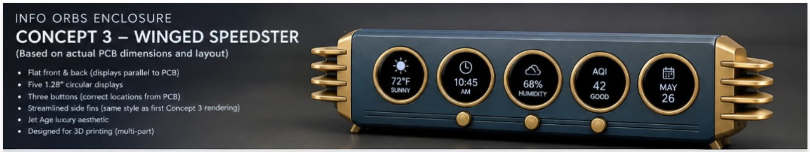

# Enclosure

## Chosen style: Concept 3, "Winged Speedster" (2026-10-17)

This is a concept rendering, not a model. It sets the look the design aims for:

- A Jet Age bar: dark blue-grey body, a brass ring bezel around each display,
  and finned brass end caps.
- Flat front and back, with the five 1.28" displays parallel to the PCB.
- Designed for 3D printing in several parts.

**Change from the rendering: the three buttons move to the top.** The rendering
shows them on the front, under the displays. The XIAO carrier board
(`hardware/hot-info-orbs-xiao/`, branch `xiao-esp32s3`) already puts its
right-angle switches on the top edge, so the board needs no change for this.

## Inputs already measured

| What | Value | Source |
|---|---|---|
| Bezel opening (lit area) | **~32.5 mm** dia; shows every pixel | [DISPLAY-EDGE-TEST.md](DISPLAY-EDGE-TEST.md) |
| Dark glass band outside it | ~1.5 mm, even all round, no pixels under it | same |
| Module pocket | the GC9A01 STEP model, caliper-checked by Scott | `hardware/hot-info-orbs/lib/3d/_Displays/` |

A bezel opening wider than ~32.5 mm shows the black band inside the brass ring.

## Screws: where the thread engages (2026-11-06)

Fasteners are **M3-0.5 socket head** (BOM). The thread is cut by the screw in
**main body front** only (Ø2.2 bosses, pilot for self-tapping). Every part the
screw passes through first gets an **M3 clearance hole, Ø3.2**.

| Part (Fusion, HOT Projects / HOT infor Orbs 1 / v0.3) | Hole | State |
|---|---|---|
| main body front | Ø2.2 bosses | thread engages here; unchanged |
| joint sleeve | Ø3.2 ×4 | v2: was Ø2.85 |
| winged end caps | Ø3.2 ×8 | v2: was Ø2.85 |
| main body back | Ø3.205 | already clearance |
| PCB assy | Ø3.2 | already clearance |
| display bezel, button bezel | n/a | no screws; leave alone |

Screw paths: the side screws run end cap → joint sleeve → front boss. The back
screws run back → PCB → front boss.

**Leftover from the #4-screw design:** the sleeve and end-cap holes were driven
by the user param `number_4_screw_thread_dia` (2.85 mm). Each of those docs now
has its own `screw_clearance_dia = 3.2 mm`, and the hole dimensions point at
that. We rejected setting `number_4_screw_thread_dia` to 3.2: a param named
"thread dia" that holds a clearance value would mislead the next editor.

**Still open:**

- The hidden `rear heel:1/:2` occurrences in the master still carry Ø2.85 holes
  at the end-cap screw positions.
- The Ø2.5 holes in display standoff were not touched.

Neither has a confirmed role in the current screw path.
