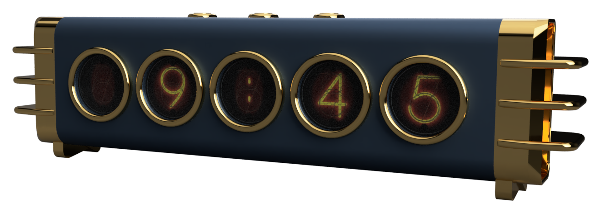
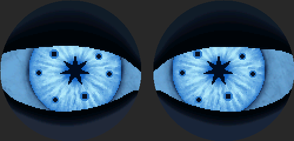
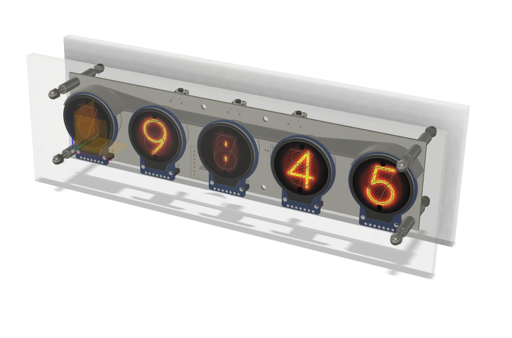

# HOT Info Orbs

*Rendering of the Winged Speedster enclosure with the Nixie clock face.*

**Five round glowing displays for your desk that show the time, weather, stock prices and anything from your smart home. You set everything up from your phone.**

HOT Info Orbs is a build-it-yourself kit from The Villages Hands-On Tech Club, based on Brett Turner's Info Orbs. It plugs into a USB-C charger and connects to your home WiFi.

## What it shows

Each page uses all five orbs. The orbs move from page to page on their own, or you can step through them with the buttons.

- **Clock:** modern digits or glowing Nixie-tube style, 12 or 24 hour, in the colors you pick.
- **Weather:** current conditions, today's high and low, a 3-day forecast, sunrise, sunset and the moon phase. It can also read your own Tempest weather station.
- **Stocks:** up to five tickers, one on each orb. No account needed.
- **Your own data:** show readings from Home Assistant or any web feed, such as the pool temperature or the front door lock. You set these up in the browser.

## Why you'll like it

- **Set up from your phone.** Change your town, tickers, clock style, colors and pages on a web page. No software or cables needed.
- **Updates over WiFi.** New versions install in under a minute and keep your settings. If an update fails, the orbs go back to the version that worked.
- **Quiet at night.** Set times for the orbs to dim or turn off, and any button wakes them.
- **Handles WiFi outages.** The orbs mark old data with an amber ring and reconnect on their own. You can also have them show the clock until WiFi returns.
- **A friendly start-up.** A pair of eyes opens and looks around while the orbs connect. You can pick from eleven eyelid styles and nine eye colors, or upload your own start-up picture.
- **Mount it either way up.** One setting flips the screens if you mount the orbs upside down.
- **Runs cool on little power.** It uses about 1.7 W, and the controller stays cool.

*The start-up eyes in the Night King style.*

## Two enclosure styles

- **Winged Speedster:** a 3D-printed Jet Age case with brass-colored rings, buttons and wings.
- **Acrylic Sandwich:** the board held between two clear acrylic panels, for a clean modern look.

*Rendering of the Acrylic Sandwich enclosure.*

## At a glance

| | |
| --- | --- |
| Displays | Five 1.28 in round color screens |
| Controls | Three buttons on top |
| Power | USB-C, 2 A charger |
| Network | 2.4 GHz WiFi |
| Needs | A free weather key (about a minute to get) |
| Source | Open source (AGPL-3.0): [github.com/scottdube/hot-info-orbs](https://github.com/scottdube/hot-info-orbs) |
