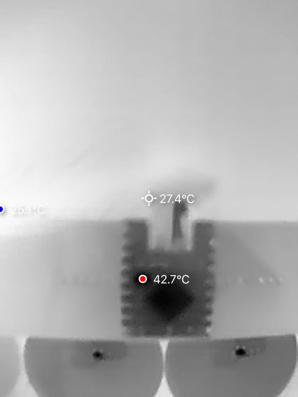
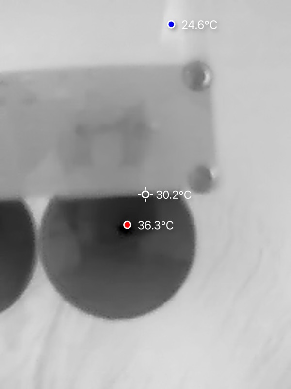

# Power: measured, 2026-09-10

Every power figure in this project was an estimate until this. Measured on the
first assembled board — five GC9A01 displays, ESP32-S3 SuperMini, running the
ported firmware on WiFi.

**Instrument:** Nordic PPK II, source meter mode, 5.000 V, 10 kSa/s, 10 s window.

| | |
|---|---|
| Average | **341.79 mA** → **1.71 W** |
| Max (10 s window) | 399.87 mA → 2.00 W |
| **Boot inrush** | **1.15 A peak**, milliseconds, measured |

## What it settles

The estimate this project ran on was ~380 mA (five displays at 40–80 mA plus an
ESP32 averaging ~80 mA). Measured 342 mA, so **the estimate was 11% high** —
close enough that everything built on it stands.

**The 5 V decision is vindicated with numbers.** Upstream powers all five
displays from the module's own 3.3 V regulator. Had this load gone that way:

```
(5.0 − 3.3) × 342 mA = 581 mW in a SOT-23-5
  → junction 112–170 °C depending on copper
  → LDO thermal shutdown is 150–165 °C
```

At or past shutdown. That is what the field reports were describing — one
builder measured 82 °C **with the radio off, running only a graphics demo**.

As built, each display regulates its own 5 V and the module's LDO carries only
the ESP32: roughly 80 mA average, ~136 mW, ~52 °C estimated. The part that was
cooking is no longer in the path. Measured on 2026-10-17: **42.7 °C** at the
module's hottest point (next section).

## Boot inrush: 1.15 A, measured

**Corrected 2026-09-10.** An earlier draft recorded this as ">1 A, clipped",
assuming the PPK II source meter limited at 1 A. It does not — it read the peak
directly at **1.15 A**.

Second capture, 3 s window at 10 kSa/s covering power-on:

| | |
|---|---|
| Peak | **1.15 A**, a single narrow spike at power-on |
| Settles to | ~240 mA |
| Then steps | ~270 mA → ~300 mA as displays come up |
| Then | ~340 mA with WiFi bursts to ~450 mA |
| Window average over the 3 s | 270 mA, 0.81 C |

The staged ramp is five display regulators starting in sequence, then the radio
joining the network.

**What it means for supply choice: 1.15 A is 3.4x the running current.** A
supply sized for the 342 mA average will sag at power-on. The failure that
produces is an orb which starts on one charger and not another, with nothing
wrong with the orb — and it will be blamed on the firmware.

## Module temperature: 42.7 °C, measured 2026-10-17

**Instrument:** a thermal camera, spot readings, default settings. **Board:** the
v1.1 carrier, ESP32-S3 SuperMini, five displays, running for hours with Wi-Fi
on and Clock, Stocks and two weather pages cycling. **Room:** 75 °F (23.9 °C).

| Spot | Reading |
|---|---|
| Hottest point on the ESP32-S3 module (four shots) | **41.8–42.7 °C** |
| Background in the same frames | 23.5–25.1 °C |
| Back of one display, hottest spot | **36.3 °C** (background 24.6 °C) |




In these images black is hottest. The module runs about **19 °C over the room**.
The HackerBox 0129 builder's report was **82 °C on the same module with the
radio off**. The 52 °C computed above was an estimate; the measurement is
about 10 °C lower.

What this does and does not show:

- These are surface readings. The silicon inside the chip is hotter than its
  surface, by an amount not measured.
- The hottest point is near the middle of the module. A second, smaller hot
  spot sits toward one side of it. Which chip each one is was not identified
  from the images.
- Emissivity was left at the camera's default, so the absolute numbers carry
  that error. The comparison between spots in the same frame does not.
- The display backs are warm (36 °C) because each one now carries its own
  regulator's share of the load.

## For pricing and supply choice

1.71 W typical, but **size the supply for the 1.15 A inrush, not the 342 mA
average**. 2 A is a sensible floor and costs nothing; 1 A is not enough despite
being nearly 3x the running current.
