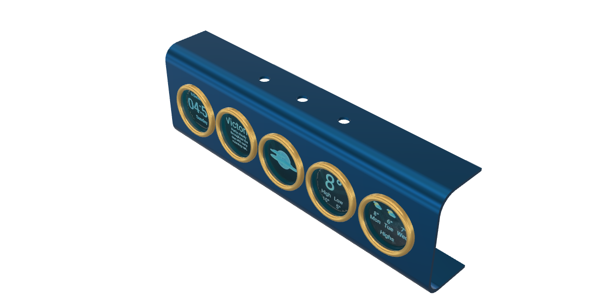

# Enclosure: overall assembly v5 (2026-10-19)

The front body with the rev 2.1 board inside and the five displays showing
screens. Everything here is on the `board-46mm-pitch` branch.




## Files

| File | Size | What |
|---|---|---|
| `overall-assembly-v5.step` | 12 MB | Front body + rev 2.1 board + five displays, one STEP. Opens in any CAD. Fusion: **File → Open** (or Insert → Insert Derive / Upload). The display pictures are not in it (decals do not export). |
| `overall-assembly-v5.f3d` | 9 MB | Fusion archive of the assembly with the decals. Not verified to open with the enclosure linked: `main_body_front` is an external reference, so if it comes in empty, upload `main_body_front-v4.f3d` to the same folder first. |
| `main_body_front-v4.f3d` | 0.3 MB | Fusion archive of the front body alone: 7 posts + 7 pins, button holes, Ø35.5 bezel holes. |
| `decals/ds*_*.png` | | The five 240 × 240 face images, cropped from `references/weather.png` (upstream brett.tech orbs, not our unit). |
| `front-mockup-v1/` | | Earlier print check on the 38.98 mm board. Superseded. |

The board itself: [`hardware/hot-info-orbs-xiao-46mm/3d-assembly/hot_info_orbs_xiao_46mm_assembly.step`](../hot-info-orbs-xiao-46mm/3d-assembly/hot_info_orbs_xiao_46mm_assembly.step)
(rev 2.1, 224.0 × 52.78 mm, KiCad export with the XIAO and one display
module placed). Fab package: [`../hot-info-orbs-xiao-46mm/fab/`](../hot-info-orbs-xiao-46mm/fab/).

## What changed from the preliminary front (v3)

- Board grown 5 mm at the top (rev 2.1): the top mounting holes moved from
  under the lip to where a post fits, so the two corner hangers are gone and
  all seven holes get a Ø6 post + Ø2.9 pin. One body.
- Button holes in the top lip are over the switch actuators; the actuator
  tops sit 12.9 mm below the lip, so a plunger or cap bridges that gap.
- Display glass sits 0.29 mm behind the plate. Interference check against
  the PCB and the nearest display: clean.
- Still open: nothing holds a module against the plate; no bezel rings or
  back cover modeled yet.

Detail and the placement recipe: [`docs/ENCLOSURE.md`](../../docs/ENCLOSURE.md).

## Getting it

```bash
git clone -b board-46mm-pitch https://github.com/scottdube/hot-info-orbs.git
```

Or download single files from the GitHub page with **Download raw file**.
