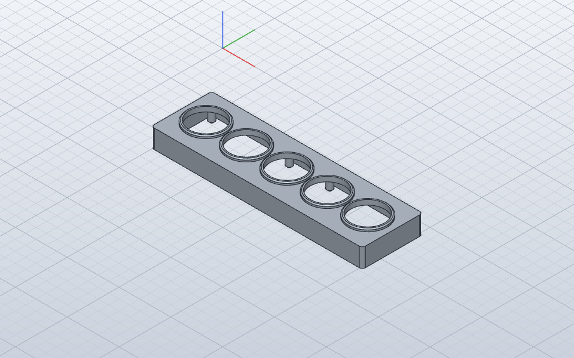

# Front mock-up v1 (Concept 3, "Winged Speedster")

A 3D-printed check of the look and size of the front. It is not the enclosure.
It drops over the real XIAO carrier board (`hot_info_orbs_xiao.kicad_pcb`,
branch `xiao-esp32s3-plus`) with the five displays fitted. Each display gets a
separate ring standing in for the brass bezel. There are no buttons: they move
to the top edge (see [ENCLOSURE.md](../../../docs/ENCLOSURE.md)).

## Files

| File | What |
|---|---|
| `front-mockup-v1.solidcraft` | Source. Sketch-driven, so change the parameters below to resize it. |
| `front-plate.3mf` | Face plate with skirt, posts and pins. Print it **face down**. |
| `bezel-ring-x5.3mf` | One bezel ring. Print **5**, flange down. Brass-colored filament or paint. |
| `front-mockup-v1.step` | All six bodies, in board coordinates. |

## Frame

Board STEP coordinates are used throughout. X is board x and Y is −board y.
Z = 0 is the board's back face, and the board top is at Z 1.6. To check it
again, insert a fresh `kicad-cli pcb export step` of the board.

## Parameters

| Name | Value | Meaning |
|---|---|---|
| `glass_top` | 15.2825 | Display glass height above the board back |
| `glass_gap` | 0.3 | Air gap between the glass and the plate underside |
| `plate_t` | 2.5 | Face thickness |
| `board_t` | 1.6 | PCB thickness |
| `hole_d` | 35 | Hole in the face that the ring spigot fits into |
| `ring_od` | 37 | Bezel ring outside diameter |
| `window` | 32.5 | Bezel opening: shows every pixel and hides the black band ([DISPLAY-EDGE-TEST.md](../../../docs/DISPLAY-EDGE-TEST.md)) |
| `ring_h` | 2.5 | Height of the ring flange above the face |
| `spigot_d` / `spigot_h` | 34.8 / 2.2 | Ring spigot that press-fits into `hole_d` |
| `post_d` / `pin_d` | 6 / 2.9 | Standoff posts that rest on the board, and pins into its mounting holes |
| `corner_r` | 3 | Outer corner radius |
| `ring_round` | 1 | Fillet on the ring's outer top edge |

## Sizes

- Face: 203.6 × 58.27 mm. Overall height is 18.08 mm to the face and 20.58 mm to the ring tops.
- Display center to center: 38.98 / 39.04 / 38.93 / 38.98 mm (mean 38.98).
  Superseded 2026-10-19: 46.0 mm on the fab board (`hardware/hot-info-orbs-xiao-46mm/`).
  The outer two are 155.93 mm apart.
- Face margin, from display center to face edge: **29.135 mm at both top and
  bottom**. The top can't shrink: the display header tab and the board's top
  edge are there. So the bottom was grown to match it, rather than swapping the
  two margins.

## Fit check (2026-10-19)

Run with SolidCraft `inspect.interference` against the board STEP:

- **0 overlaps** between the mock-up (plate + 5 rings) and the PCB, headers,
  sockets, passives or the display module.
- The tightest point is **0.35 mm**, between the display PCB's top edge
  (Y −61.95) and the skirt's inner wall (Y −61.6).
- Caveat: the board STEP models **one** display, position 2 (X ≈ 111.7). The
  other four use the same footprint, so they are assumed to clear the same way.
  This was not measured.

## Built the Fusion way

Every feature comes from a named sketch: Skirt, Face, Posts, Pins, Ring flange
and Ring spigot. Each is extruded by a parameter, then the Corners fillet and
the per-ring fillets are applied. An earlier build used primitives and left no
sketches to edit, so it was thrown away.
